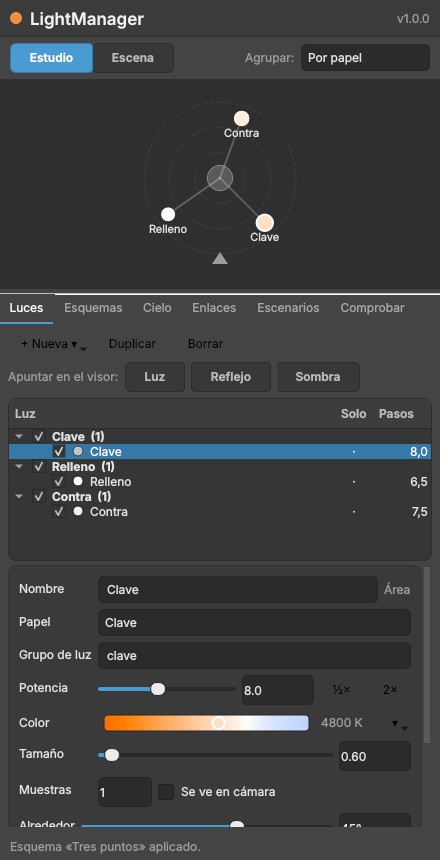

# LightManager

Gestor de luces de Arnold para Autodesk Maya (2026 y 2027, Mac y Windows). Forma parte de
[MantiTools](https://github.com/adrianmantilla/mantitools), grupo *Look y render*, junto a Materials y RenderDesk.



Un panel acoplable con todas las luces de la escena, agrupadas por papel o por zona, que se encienden, se ponen en
solo y se ajustan en **pasos** (un paso más es el doble de luz) y **Kelvin**. Tiene dos modos que comparten lista,
ficha, escenarios y comprobaciones:

- **Estudio**: luces alrededor de un objeto. Esquemas (tres puntos, producto, Rembrandt…), vista de órbita desde
  arriba para girar las luces arrastrándolas y «Apuntar» con un clic en el visor (luz, reflejo o sombra).
- **Escena**: interiores y exteriores a medida. Zonas por habitación, portales en las ventanas, bombillas en las
  lámparas, mallas convertidas en luz, luces pegadas a una superficie con perfiles IES, filas de luces gemelas y
  un sol físico por hora, fecha y lugar que enciende las lámparas al anochecer.

*English summary: LightManager is a dockable Arnold light manager for Maya. Studio mode places lights around an
object (schemes, top-down orbit view, click-to-aim for light, highlight or shadow); Scene mode handles custom
interiors and exteriors (rooms as zones, window portals, lamp bulbs, mesh lights, IES fixtures, twin light rows,
physical sun by time/date/place). Power in stops and colour in Kelvin, HDRI library with a free CC0 starter pack,
light linking matrix, light-group AOVs, saved lighting setups with hold-to-compare, and checks with one-click fixes.
A small Python API lets RenderDesk and other tools list and drive the lights. Spanish UI, ready for translation.*

## Instalar

1. Descarga o clona esta carpeta y déjala donde vaya a quedarse (por ejemplo `Documentos/maya/LIGHTMANAGER`).
2. Abre Maya con Arnold (MtoA) cargado y arrastra `instalar.py` desde el Finder o el Explorador hasta el visor.
3. Aparece el menú **LightManager** (o dentro de **MantiTools**, si lo tienes). Se carga solo cada vez que abres Maya.

Para desinstalar, borra `lightmanager.mod` de la carpeta `modules` de tus preferencias de Maya (la ruta sale en el
Script Editor al instalar).

## Qué hace

| | |
|---|---|
| **Lista de luces** | Todas las luces de Maya y de Arnold, agrupadas por papel (clave, relleno, contra…), zona, tipo o grupo de luz. Casilla para encender, «S» para solo, potencia en pasos. Clic derecho: encender solo ese grupo, quitar todos los solos. |
| **Ficha** | Nombre, papel, zona, grupo de luz, potencia (con ½× y 2×), color en Kelvin con atajos (vela, tungsteno, flash…), tamaño, perfil IES, muestras, visible en cámara y, en Estudio, alrededor/altura/distancia. Debajo, los valores reales de Arnold. |
| **Esquemas** | De estudio (crean las luces alrededor de lo seleccionado, mirando desde la cámara de render), de interior y de exterior (ajustan sol, cielo y prácticas). «Guardar las luces como esquema» los añade a *Mis esquemas*. |
| **Apuntar** | Con una luz elegida, clic en el visor: *Luz* la pone de frente a ese punto, *Reflejo* hace que su brillo caiga ahí visto desde la cámara y *Sombra* hace que la sombra del objeto caiga donde se hace clic. |
| **Vista** | En Estudio, la órbita: el objeto en el centro, la cámara abajo y las luces alrededor; se arrastran para girarlas y la rueda cambia su altura. En Escena, un visor de Maya desde arriba (o por la cámara de render) dentro del panel. |
| **Zonas** | Cajas `LM_zona_<nombre>` en el grupo `LM_zonas`: desde los objetos seleccionados, dibujando un rectángulo en la vista o una por grupo del Outliner. Cada luz toma la zona en la que está (o la que se le fije). |
| **Escena** | *Colocar* pega una luz a la pared, el techo o el suelo con un clic; *Ventanas → portales*, *Lámparas* (bombilla sin la sombra de la pantalla), *Malla → luz* y *Repetir* (copias gemelas en fila, que cambian juntas). |
| **Cielo** | Biblioteca de HDRI con miniaturas (carpeta propia y un pack de 8 HDRI CC0 de Poly Haven que se descarga con un botón), giro, potencia, *Sol desde el HDRI* y cielo físico. Sol por lugar, fecha y hora con salida y puesta, norte de la escena y lámparas que se encienden al anochecer. |
| **Enlaces** | Matriz luz × objeto: ilumina y hace sombra, ilumina sin sombra o no le afecta (light linking y shadow linking de Arnold). Grupos de luz y sus AOV `RGBA_<grupo>`. |
| **Escenarios** | Fotos del estado de las luces (y del sol) guardadas en la escena. Recuperar, borrar y *Comparar*: mientras se mantiene pulsado se ve el escenario y al soltar vuelve todo. |
| **Comprobar** | Semáforo con arreglo de un clic: sin luces, solo olvidado, sombras negras, luces que no se notan, áreas estiradas, caída no cuadrática, HDRI sin `.tx` o perdido, portales sin cielo, bombillas tapadas por su pantalla, muestras altas, luces sin nombre y áreas visibles en cámara. |

Todo se deshace con un solo `Ctrl+Z` por acción.

## RenderDesk y otras herramientas

`lightmanager.api` funciona sin abrir el panel:

```python
from lightmanager import api
api.listar()                                   # [{nombre, tipo, pasos, kelvin, grupo, activa…}]
api.potencia("LM_Clave", 1, relativo=True)     # un paso más
api.solo("LM_Relleno")
api.crear_aovs()                               # AOV de grupos de luz
api.llevar_mezcla({"clave": -0.5})             # la mezcla hecha sobre el render, de vuelta a las luces
api.comprobar(); api.arreglar("solo")
```

RenderDesk la usa para su pestaña de luces, la mezcla con el *light mixer* de Arnold y su pestaña Comprobar.

## Ajustes

En `<preferencias de Maya>/lightmanager/ajustes.json` (también desde la ventana central de MantiTools): carpetas de
HDRI, de *Mis esquemas* y de perfiles IES, lugar por defecto del sol, norte de la escena, modo al abrir (automático
según la escena, Estudio o Escena), cómo agrupar en cada modo y si se ven los valores de Arnold en la ficha.

## Para desarrollar

```
python -m pytest tests                 # núcleo y panel sin Maya (PySide6 para las del panel)
mayapy herramientas/prueba_maya.py     # dentro de Maya, con Arnold
```

La interfaz está en `scripts/lightmanager/i18n/es.json`; para otro idioma, copia el archivo (`en.json`…) y
pon `LIGHTMANAGER_IDIOMA=en`.

## Licencia

MIT (ver `LICENSE`). Los HDRI del pack inicial son de [Poly Haven](https://polyhaven.com) con licencia CC0 y no se
incluyen en el repositorio: se descargan al pulsar el botón.
